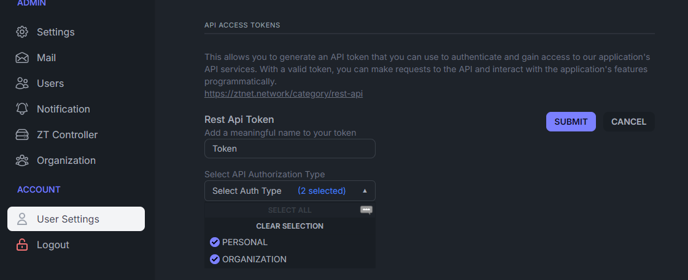

# [ZTNet](https://github.com/sinamics/ztnet) DNS Server

This project aims to provide a DNS server for a specific network in zerotier. It uses `coredns` as the DNS server and ZTNet's API to get the list of devices in the network and assign them in a zone file.

The container runs three programs under `supervisord`:

- `zerotier-one`, which joins the container to your network so the DNS server is reachable on its ZeroTier address.
- `coredns`, which answers queries for `DNS_DOMAIN` from the zone file and forwards all other queries to `DNS_UPSTREAM`.
- `zone-updater.sh`, which fetches the network members from the ZTNet API every `ZONE_REFRESH_INTERVAL` seconds and rewrites the zone file when the members change.

Image versions:

| Component | Version |
| --- | --- |
| Base image | `ubuntu:24.04` |
| CoreDNS | 1.15.0 |
| ZeroTier One | 1.16.2 |

The CoreDNS and ZeroTier versions can be changed with the `COREDNS_VERSION` and `ZEROTIER_VERSION` build arguments.

## Warning

> This project is only designed to work with ZTNet API and inside a docker container, if you have other use cases like running it on my.zerotier.com, you can adapt a few things like `scripts/zt2zone.sh` script and get it working for you. Or to run without docker container you can use the same script, run it with crontab or something and use the zonefile however you like.

## Deployment

The deployment is done using docker. You can run the service on any of your servers or next to your ZTNet instance.

1. Copy `.env.example` to `.env` and fill in `NETWORK_ID`, `ZTNET_API_HOST` and `ZTNET_API_TOKEN`.
2. Build and start the container with the included `docker-compose.yml`:

   ```bash
   docker compose up -d --build
   ```

3. The container joins `NETWORK_ID` on start. Authorize the new member in the ZTNet web interface.
4. Find the container's ZeroTier address:

   ```bash
   docker exec ztnet-dns zerotier-cli listnetworks
   ```

5. In the network's DNS settings in ZTNet, set the search domain to `DNS_DOMAIN` and the server address to the container's ZeroTier address. ZeroTier clients that allow DNS configuration will then resolve `<member-name>.<DNS_DOMAIN>`.

To join manually instead, set `ZT_AUTO_JOIN=false` and run:

```bash
docker exec -it ztnet-dns zerotier-cli join <NETWORK_ID>
```

### Running next to ZTNet

If you run the service in the same compose project as ZTNet, add it to that file:

```yaml
services:
  dns:
    build: https://github.com/Duoquote/ztnet-coredns.git
    container_name: ztnet-dns
    restart: unless-stopped
    devices:
      - /dev/net/tun # Required
    cap_add:
      - NET_ADMIN # Required
    environment:
      # ORG_ID: <YOUR_ORG_ID> # Optional
      NETWORK_ID: <YOUR_NETWORK_ID>
      ZTNET_API_HOST: http://ztnet:3000
      ZTNET_API_TOKEN: <YOUR_ZTNET_API_TOKEN>
      DNS_DOMAIN: next.vpn
    depends_on:
      - ztnet
    volumes:
      - dns:/var/lib/zerotier-one
    networks:
      - app-network

volumes:
  # Add to the existing volumes section.
  dns:
```

`ZTNET_API_HOST` can then point at the ZTNet service name. `http://ztnet:3000` and `app-network` match ZTNet's default compose file; adjust them if your service name, port or network differ.

### Environment Variables

| Variable | Required | Default | Description |
| --- | --- | --- | --- |
| `NETWORK_ID` | Yes | | The id of the network. Several ids can be given, separated by spaces or commas. |
| `ZTNET_API_HOST` | Yes | | The address of the ZTNet Web Interface, it can be an IP address too. Example: `https://xxx.zerotier.tld`, `http://x.x.x.x:3000`. |
| `ZTNET_API_TOKEN` | Yes | | The API token from ZTNet Interface. See [How to obtain the API Token](#how-to-obtain-the-api-token). |
| `ORG_ID` | No | | The organization id in ZTNet if the network is in an organization. |
| `DNS_DOMAIN` | No | `zt.vpn` | The domain name to use for the DNS server (e.g. `desktoppc.zt.vpn`). |
| `DNS_TTL` | No | `600` | TTL of the records, in seconds. |
| `DNS_UPSTREAM` | No | `1.1.1.1 1.0.0.1 8.8.8.8 8.8.4.4` | Servers that queries outside `DNS_DOMAIN` are forwarded to, separated by spaces. |
| `ZONE_REFRESH_INTERVAL` | No | `30` | Seconds between zone updates. |
| `ZTNET_API_RETRIES` | No | `3` | Attempts per API request before an update is given up. |
| `ZTNET_API_RETRY_DELAY` | No | `5` | Seconds between attempts. |
| `ZTNET_API_TIMEOUT` | No | `30` | Timeout of a single API request, in seconds. |
| `ZT_AUTO_JOIN` | No | `true` | Join the networks in `NETWORK_ID` on start. |
| `COREFILE` | No | | Path to a custom Corefile inside the container. When unset, the Corefile is generated from the variables above. |

ZTNet allows 50 API requests per minute by default. Each update makes one request per network, so keep `ZONE_REFRESH_INTERVAL` above a few seconds when you list several networks.

### Records

Only authorized members get records. Each member gets an `A` record for every IPv4 assignment and an `AAAA` record for every IPv6 assignment, plus a wildcard record for subdomains. Member names are lowercased, and characters other than letters, digits and `-` are replaced with `-`. Members without a name use their member id.

A network with the members `Desktop PC` (`172.25.25.31`) and `laptop` (`172.25.25.32`) and `DNS_DOMAIN=next.vpn` produces:

```
; ZeroTier DNS records for *.next.vpn
$ORIGIN next.vpn.
$TTL 600
@ IN SOA ns1.next.vpn. admin.next.vpn. ( 1795698210 10800 3600 604800 600 )
@ IN NS ns1.next.vpn.
; Records for network ID: 8056c2e21c000001
desktop-pc.next.vpn.	IN	A	172.25.25.31
*.desktop-pc.next.vpn.	IN	A	172.25.25.31
laptop.next.vpn.	IN	A	172.25.25.32
*.laptop.next.vpn.	IN	A	172.25.25.32
```

The zone is written to a temporary file and moved into place, so CoreDNS never reads a partial file. If the API cannot be reached, the previous zone stays in use and the error is logged.

### Logs and health check

All three programs log to the container output:

```bash
docker logs -f ztnet-dns
```

The image has a Docker health check. The container is reported healthy when CoreDNS responds, ZeroTier is online and the zone was updated from the ZTNet API within the last three refresh intervals (at least five minutes). A custom Corefile needs `health 127.0.0.1:8080` for the check to pass.

### How to obtain the API Token

Go to your ZTNet Web Interface and click on the `User Settings` on left side menu. Then go to the `API ACCESS TOKENS` section and create a new token. Select `PERSONAL` as the authorization type for a personal network, or `ORGANIZATION` if you set `ORG_ID`. If you set an expiration date, replace the token before it expires.



## Building

```bash
docker build -t ztnet-coredns .
```

To use other versions of CoreDNS or ZeroTier:

```bash
docker build --build-arg COREDNS_VERSION=1.15.0 --build-arg ZEROTIER_VERSION=1.16.2 -t ztnet-coredns .
```

## Running the script without Docker

`scripts/zt2zone.sh` prints the zone to stdout and needs `bash`, `curl` and `jq`:

```bash
export ZTNET_API_HOST=https://ztnet.example.com
export ZTNET_API_TOKEN=<YOUR_ZTNET_API_TOKEN>
export DNS_DOMAIN=next.vpn
./scripts/zt2zone.sh <NETWORK_ID> > zt.zone
```

## License

[MIT](LICENSE)
